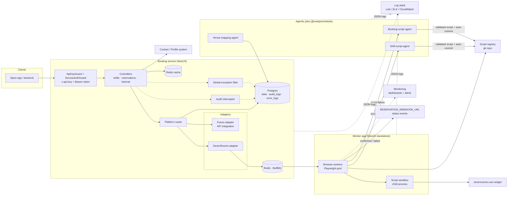
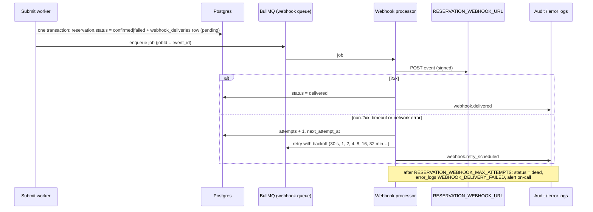
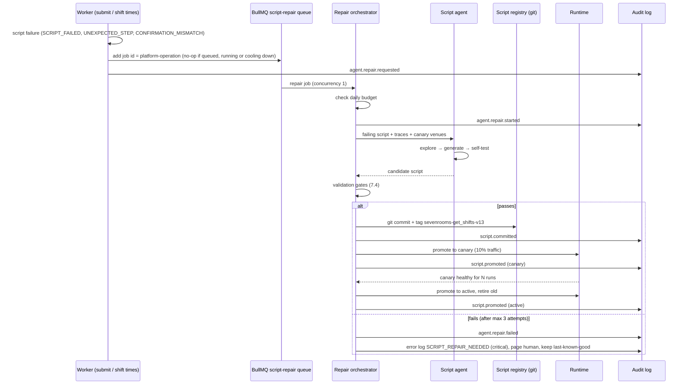

# Booking Service — Design

Status: draft v0.5 · 2026-11-16 · **Pilot**: the SevenRooms browser automation is a temporary bridge until a
partner API or another integration replaces it.

## 1. Goal

A **NestJS (TypeScript)** service that books restaurant tables through outside reservation platforms for Spice
restaurants, behind one stable API. The first platform is **SevenRooms**, which has no API we can use, so we drive its
public booking widget with a headless browser (Playwright). Platforms added later plug in through real API integrations.

Browser scripts break whenever the platform changes its UI. So the service keeps them up to date by itself: when a
script **fails**, an **agentic job** repairs it and **auto-commits** a fixed version. Every final reservation status is
**pushed** to the caller through a signed webhook.

Callers authenticate with an **API key** (`x-api-key`). Every state-changing action is written to an **audit log**, and
every error is captured in structured **error logs** (§8).

### Non-goals (pilot)
- Cancelling or changing a booking (planned for v2; the adapter interface leaves room for it).
- **Any user action, at any point.** A booking either completes automatically or ends `failed`. Every final status is
  pushed through the reservation status webhook (§4.5). There are no handoff links and no steps for the user to finish.
- Solving CAPTCHAs or evading bot detection. A challenge page fails the booking with `PLATFORM_BLOCKED`.

---

## 2. High-level architecture



**Main ideas**
1. **Adapter per platform.** All callers use one interface (`ReservationProvider`). SevenRooms is one implementation.
   A later platform with a real API is another, and nothing else in the service changes.
2. **Scripts are data, not code that ships with the service.** The browser scripts the agents write live in a separate
   *script registry* (a git repo), have versions, and run in a sandbox. Fixing a broken script never needs a service deploy.
3. **Agents only produce scripts. They never serve user requests.** User requests run a fixed, validated script and never
   call an LLM, so response times and behaviour stay predictable.
4. **Two deployables from one Nest monorepo**: `api` (HTTP) and `worker` (BullMQ processors, browsers, agents, scheduler).
   Browsers are heavy and must not share a process with the API.

---

## 3. Authentication: `x-api-key`

Every request (public and internal) must carry `x-api-key: <key>` **and** the other-service token (§3.1). Only `GET /health` is exempt.

**Key format**: `bks_<env>_<prefix>_<secret>`, for example `bks_live_a1b2c3d4_<32 random bytes base62>`.
- `prefix` (8 chars) is stored in clear text for lookup and safe logging.
- Only a **hash** of the full key is stored (SHA-256 with a server-side pepper; keys are long random values, so a slow hash isn't needed).
- The full key is shown **once** at creation and never again.

**`ApiKeyGuard`** (global `APP_GUARD`):
1. Read `x-api-key`. Missing or malformed → `401 UNAUTHORIZED`.
2. Look up by `prefix`, then compare hashes in constant time (`crypto.timingSafeEqual`).
3. Check `status = active` and `expires_at`. Then check that the key's **scopes** cover the route, using `@Scopes('reservations:write')` metadata on the handler.
   Missing scope → `403 FORBIDDEN`.
4. Attach `req.apiClient = { clientId, keyPrefix, scopes }` for audit and logs. Update `last_used_at` asynchronously, at most once per minute.
5. Every denied attempt is written to the audit log as `auth.denied`, with the key prefix only.

**Scopes**

| Scope | Routes |
|---|---|
| `shifts:read` | `GET /v1/restaurants/:id/shifts` |
| `reservations:write` | `POST /v1/reservations` |
| `reservations:read` | `GET /v1/reservations`, `GET /v1/reservations/:id` |
| `admin` | everything under `/internal/*` |

**Operations**
- Several active keys per client allow rotation without downtime: create the new key, switch clients over, revoke the old one.
- Rate limiting per key uses `@nestjs/throttler` with Redis storage, for example 60 req/min for shifts and 10 req/min for reservations.
- Keys are created and revoked through `POST/DELETE /internal/api-keys` (scope `admin`) and a CLI command (`npm run apikey:create`) for the first admin key.
- The raw key never appears in logs, errors or audit rows. The logger's redact list covers the `x-api-key` header.

### 3.1 Second layer: other-service authentication (on every call)

Every call carries **two credentials**:

| Header | What it proves | Checked by |
|---|---|---|
| `x-api-key` | The calling system may use the booking service | `ApiKeyGuard` (above) |
| `Authorization: Bearer <token>` (header name configurable: `SERVICE_AUTH_HEADER`) | The caller's identity in the other services (Spice / Contact system) | `ServiceAuthGuard`, then forwarded downstream |

Both guards run on every route except `/health`, and both must pass. Order: `ApiKeyGuard` → `ServiceAuthGuard`.

**`ServiceAuthGuard`**
1. Missing token → `401 SERVICE_AUTH_REQUIRED`.
2. Validate the **JWT** locally with the `jose` library (`jwtVerify` + `createRemoteJWKSet`). No network call per request:
   - **Signature**: keys come from the issuer's JWKS URL, cached in memory (default 10 min). If the `kid` is unknown, refresh the keys once, at most every 30 s, so key rotation works.
   - **Algorithms**: only an allowlist (`RS256`, `ES256`). `none` and `HS*` are rejected, which stops algorithm-confusion attacks.
   - **Claims**: `iss` must equal the configured issuer, `aud` must include the booking service's audience, and `exp`/`nbf` are checked with 30 s clock skew.
     `sub` is required. Optional `scope`/`roles` claims are exposed for future per-user authorization.
   - Invalid, expired or wrong issuer/audience → `401 INVALID_SERVICE_TOKEN`. The log line records the reason (`expired`, `bad_signature`, `wrong_audience`…), never the token.
   - If the JWKS endpoint is down, tokens signed with already-cached keys still validate. A new `kid` with no reachable JWKS → `503 SERVICE_AUTH_UNAVAILABLE`, recorded in the error log.
3. Optional binding check: the token's client/tenant claim must match the API key's `api_clients.allowed_issuers / tenant`.
   This stops a valid key from being paired with another tenant's token (`403 FORBIDDEN`).
4. Attach `req.principal = { subject, userRef, issuer, claims }`. `userRef` = HMAC(subject) is what audit and logs record.
5. Keep the raw token only on the request object, for forwarding.

**Forwarding rules**
- The token is forwarded **only** to allowlisted downstream services (Contact system, Spice API) by a shared `DownstreamHttpClient`.
  That client adds the header itself, so feature code never handles the raw token.
- It is **never** sent to SevenRooms, never passed to browser scripts or agents, never put in BullMQ jobs, and never stored, logged or audited.
- Because the booking is asynchronous and tokens expire, the **contact lookup happens inside the API request**, before the job is enqueued.
  The worker only receives the encrypted contact details (§9), never the token.
- Background jobs (Spice sync, agents) have no user token. They call other services with the booking service's **own** credentials
  (client-credentials grant or a service key from the secret manager).

**Config**
`SERVICE_AUTH_HEADER` (default `authorization`), `SERVICE_AUTH_JWKS_URL`, `SERVICE_AUTH_ISSUER`, `SERVICE_AUTH_AUDIENCE`,
`SERVICE_AUTH_ALGORITHMS` (default `RS256,ES256`), `SERVICE_AUTH_CLOCK_SKEW_S` (default 30), `SERVICE_AUTH_TENANT_CLAIM`, `DOWNSTREAM_ALLOWLIST`.

**Testing**: tests sign tokens with a locally generated key pair and a JWKS served by a stub. No dependency on the real issuer.

---

## 4. Public API

Base path `/v1`. JSON in and out. Every response carries `x-request-id`, taken from the request or generated.

### 4.1 Get shift times
```
GET /v1/restaurants/:restaurantId/shifts?date=2026-11-20&party_size=4
x-api-key: bks_live_...
Authorization: Bearer <other-service token>
```
Both `date` and `party_size` are **required** and validated with `class-validator` DTOs. `party_size` must be an integer
from 1 to the restaurant's `max_party_size` (default 20). The script enters it in the widget's guest picker, because the
available times depend on it.

Response `200`:
```json
{
  "restaurant_id": "spice-123",
  "date": "2026-11-20",
  "party_size": 4,
  "platform": "sevenrooms",
  "shifts": [
    {
      "shift_id": "dinner",
      "name": "Dinner",
      "slots": [
        {"time": "19:00", "slot_token": "opaque-abc", "available": true},
        {"time": "19:30", "slot_token": "opaque-def", "available": true}
      ]
    }
  ],
  "fetched_at": "2026-11-16T10:02:11Z",
  "cache_ttl_s": 120
}
```
- `slot_token` is an opaque, HMAC-signed value holding venue, shift, time and **party size**. The client sends it back to book, so the two calls always agree.
- Only slots the automation can book are returned. Slots the availability data marks as needing anything beyond the standard form are left out.
- Results are cached in Redis for 1–3 minutes per `(venue, date, party_size)`.

### 4.2 Submit reservation
```
POST /v1/reservations
x-api-key: bks_live_...
Authorization: Bearer <other-service token>
Idempotency-Key: <uuid>
{
  "restaurant_id": "spice-123",
  "datetime": "2026-11-20T19:00:00+04:00",
  "party_size": 4,
  "slot_token": "opaque-abc",
  "notes": "window seat if possible"
}
```
`party_size` is required. `slot_token` is optional, but required if `datetime` alone is ambiguous. `notes` is optional.

Steps:
1. **Resolve the venue**: `venue_mapping(restaurant_id, platform) → venue_id`. Return `422 VENUE_NOT_MAPPED` if there is no mapping or it isn't verified.
2. **Get contact details**: call the Contact/Profile system, forwarding the other-service token (§3.1), to get name, phone and email.
   This happens inside the request, so the token never reaches the queue. Contact details are held in memory only for the job (§9).
   The Contact system's endpoints are **environment variables**:

   | Env var | Example / default | Purpose |
   |---|---|---|
   | `CONTACT_API_BASE_URL` | `https://contacts.internal.spice.example` (**required**) | Base URL of the Contact system |
   | `CONTACT_API_CONTACT_PATH` | `/v1/me/contact` (**required**) | Endpoint that returns the caller's name, phone and email |
   | `CONTACT_API_TIMEOUT_MS` | `3000` | Per-call timeout |
   | `CONTACT_API_RETRIES` | `1` | Retries on timeout or 5xx only |

   All of them are checked at startup with a `@nestjs/config` + zod schema, so a missing or malformed URL stops the app from booting.
   The host of `CONTACT_API_BASE_URL` is added to `DOWNSTREAM_ALLOWLIST` automatically, so the JWT can be forwarded there.
   A timeout, 5xx or unreadable response → `502 CONTACT_LOOKUP_FAILED`, and nothing is queued.
3. **Submit**: put a `submit` job on BullMQ. A worker runs the active `submit` script for the platform:
   - It enters `party_size` in the guest picker.
   - Before reporting `confirmed`, it reads the confirmation screen and checks that date, time and **party size** match the request. A mismatch → `failed / CONFIRMATION_MISMATCH`.
   - If a `slot_token` is sent, its party size must equal `party_size`; otherwise the API returns `422`.
   - If checkout shows anything the script doesn't expect, it stops **without submitting** and the reservation ends `failed`:
     `PLATFORM_BLOCKED` for a challenge page, `UNEXPECTED_STEP` for any other unknown screen or field.
   - **Retries**: the worker retries a failure (at most 2 times, with backoff) **only if it happened before the final confirm click**,
     for example a timeout or `PLATFORM_UNAVAILABLE`. If the confirm click happened but no confirmation was read, the result is
     `failed / OUTCOME_UNKNOWN` and the booking is **never** retried, to avoid a double booking.
   - Every reservation that reaches a final status (`confirmed` or `failed`) sends one event to the reservation status webhook (§4.5).
   - A script failure (`SCRIPT_FAILED`, `UNEXPECTED_STEP`, `CONFIRMATION_MISMATCH`) also starts the self-healing loop (§7.5).

The booking flow takes 10–40 s in a browser, so the call is **asynchronous**:
- Returns `202 {"reservation_id": "...", "status": "pending"}`
- The final status is **pushed** through the reservation status webhook (§4.5): `reservation.confirmed` with the
  `platform_confirmation_code`, or `reservation.failed` with the `error_code`. Callers don't need to poll.
- `GET /v1/reservations/:id` → `pending | confirmed | failed` stays available as a fallback and for reconciliation.

### 4.2.1 List reservations
```
GET /v1/reservations?filter=upcoming&status=confirmed&limit=20&cursor=res_01JD…
```
Scope `reservations:read`. Returns the **calling user's** reservations: same API client, same user (the JWT `sub`,
stored as the hashed `user_ref`). `GET /v1/reservations/:id` uses the same rule, so one user can't read another's booking.

| Param | Values | Default | Meaning |
|---|---|---|---|
| `filter` | `upcoming` · `previous` · `all` | `all` | `upcoming`: reservation time is now or later, soonest first. `previous`: before now, latest first. `all`: latest first |
| `status` | `pending` · `confirmed` · `failed` | any | Optional extra filter |
| `limit` | 1–100 | 20 | Page size |
| `cursor` | `next_cursor` from the previous page | none | Cursor pagination, stable while new bookings arrive |

```json
{
  "filter": "upcoming",
  "data": [
    {
      "reservation_id": "res_01JD3J…",
      "status": "confirmed",
      "restaurant_id": "spice-123",
      "datetime": "2026-11-20T15:00:00.000Z",
      "party_size": 4,
      "platform_confirmation_code": "ABC123",
      "created_at": "…",
      "updated_at": "…"
    }
  ],
  "next_cursor": null
}
```

`Idempotency-Key` is required. Repeating a request with the same key and the same API client returns the original
reservation. The same key with a different body → `409 IDEMPOTENCY_CONFLICT`.

### 4.3 Error response format
All errors use one shape, produced by the global exception filter (§8.2):
```json
{
  "error": {
    "code": "VENUE_NOT_MAPPED",
    "message": "Restaurant spice-123 has no verified SevenRooms venue.",
    "request_id": "01JD3K…",
    "details": [{"field": "party_size", "issue": "must be <= 20"}]
  }
}
```

| HTTP | `code` |
|---|---|
| 400 | `VALIDATION_ERROR` |
| 401 | `UNAUTHORIZED` (API key), `SERVICE_AUTH_REQUIRED`, `INVALID_SERVICE_TOKEN` |
| 503 | `SERVICE_AUTH_UNAVAILABLE` (issuer keys unreachable for an unknown `kid`) |
| 403 | `FORBIDDEN` |
| 404 | `RESTAURANT_NOT_FOUND`, `RESERVATION_NOT_FOUND` |
| 409 | `IDEMPOTENCY_CONFLICT`, `SLOT_UNAVAILABLE` |
| 422 | `VENUE_NOT_MAPPED`, `VENUE_NOT_BOOKABLE`, `INVALID_SLOT_TOKEN` |
| 429 | `RATE_LIMITED` |
| 502 | `CONTACT_LOOKUP_FAILED`, `PLATFORM_UNAVAILABLE` |
| 500 | `INTERNAL_ERROR` (no internals leaked; look it up by `request_id`) |

Failures of the async booking (`PLATFORM_BLOCKED`, `UNEXPECTED_STEP`, `SLOT_UNAVAILABLE`, `CONFIRMATION_MISMATCH`,
`OUTCOME_UNKNOWN`, `PLATFORM_UNAVAILABLE`, `SCRIPT_FAILED`) appear in the
reservation's `error_code`, not as HTTP errors.

### 4.4 Internal / admin API (scope `admin`)
- `GET/POST/PATCH /internal/restaurants` maintains restaurants by hand during the pilot (`source=manual`). CSV import is supported too.
- `GET/PATCH /internal/venue-mappings` lets people review and approve low-confidence mappings.
- `GET /internal/scripts` lists active and candidate script versions; `POST /internal/scripts/:id/rollback` rolls one back.
- `POST /internal/agents/:job/run` triggers an agent job by hand.
- `POST /internal/api-keys` (returns the key once), `GET /internal/api-keys`, `DELETE /internal/api-keys/:id`.
- `GET /internal/audit-logs?actor=&action=&resource_type=&resource_id=&from=&to=` searches the audit log (§8.1).
- `GET /internal/error-logs?source=&code=&fingerprint=&from=&to=` searches the error log (§8.2).
- `GET /internal/webhook-deliveries?status=` lists status-webhook deliveries; `POST /internal/webhook-deliveries/:eventId/replay` sends one again.

### 4.5 Reservation status webhook

Whenever a reservation reaches a **final status**, the service pushes it to **one webhook URL taken from an environment
variable**. Two event types:

| Event | When | Key fields |
|---|---|---|
| `reservation.confirmed` | The booking went through and the confirmation screen matched the request | `platform_confirmation_code` |
| `reservation.failed` | The booking ended `failed`, for any reason | `error_code`, `error_message`, `submitted` |

Each reservation sends exactly one event: only a `pending` reservation can change status, and the change and the event are
written together. Requests rejected before the `202` (bad input, auth, unknown venue) are returned to the caller directly
and don't go to the webhook.

**Config**

| Env var | Default | Purpose |
|---|---|---|
| `RESERVATION_WEBHOOK_URL` | none, **required** (startup fails if missing) | Where status events are POSTed |
| `RESERVATION_WEBHOOK_SECRET` | none, **required** | HMAC-SHA256 key for signing |
| `RESERVATION_WEBHOOK_TIMEOUT_MS` | `5000` | Per-attempt timeout |
| `RESERVATION_WEBHOOK_MAX_ATTEMPTS` | `8` | Attempts before an event is marked `dead` |

**Flow**



- **Outbox**: the status change and its webhook row are saved in the same transaction, so an event is never lost, even if Redis is down.
  A sweeper job re-queues `pending` rows whose `next_attempt_at` is more than 5 minutes past.
- **At-least-once**: the receiver may get the same event twice and should de-duplicate by `event_id`.
- **Replay**: a `dead` event can be sent again from the admin API (audited as `webhook.replayed`).
- 4xx responses other than 408 and 429 are treated as permanent and go straight to `dead`, because retrying won't help.

**Request**
```
POST $RESERVATION_WEBHOOK_URL
Content-Type: application/json
x-booking-event-id: evt_01JD3K…
x-booking-timestamp: 1763287331
x-booking-signature: sha256=<hex HMAC-SHA256(RESERVATION_WEBHOOK_SECRET, timestamp + "." + raw body)>
```
Both event types use one body shape. Fields that don't apply are `null`.
```json
{
  "event_id": "evt_01JD3K…",
  "type": "reservation.confirmed",
  "occurred_at": "2026-11-20T15:02:11Z",
  "reservation_id": "res_01JD3J…",
  "status": "confirmed",
  "restaurant_id": "spice-123",
  "platform": "sevenrooms",
  "venue_id": "rowon45",
  "datetime": "2026-11-20T15:00:00.000Z",
  "party_size": 4,
  "platform_confirmation_code": "ABC123",
  "error_code": null,
  "error_message": null,
  "submitted": true,
  "booking_attempts": 1,
  "script_version": "sevenrooms/submit/v7",
  "api_client_id": "cli_spice_backend",
  "request_id": "01JD3J…"
}
```
A `reservation.failed` event has `"status": "failed"`, `"platform_confirmation_code": null` and the `error_code` /
`error_message` filled in, e.g. `"error_code": "PLATFORM_BLOCKED"`.
- `submitted` tells the receiver whether the confirm click happened. On a failure it's `false` except for `OUTCOME_UNKNOWN`, where someone should check with the venue.
- The payload never contains contact details, tokens or API keys.
- The receiver should verify the signature and reject timestamps older than 5 minutes.

---

## 5. Platform adapter interface

```ts
export interface ReservationProvider {
  readonly platform: 'sevenrooms' | string;
  getShifts(venueId: string, date: string, partySize: number, ctx: RequestContext): Promise<Shift[]>;
  submit(venueId: string, req: BookingRequest, contact: Contact, ctx: RequestContext): Promise<BookingResult>;
  healthCheck(): Promise<HealthResult>;   // used by monitoring
}
```
Providers are registered with a Nest injection token (`RESERVATION_PROVIDERS`) and picked by `PlatformRouter` from `venue_mappings.platform`.

- **SevenRooms adapter**: loads the active script version for `(sevenrooms, get_shifts | submit)` from the registry and runs it
  in a worker. Output is validated with **zod** schemas.
- **API adapters** (later): ordinary hand-written HTTP clients (`@nestjs/axios`). They don't need the script registry or agents.

`RequestContext` = `{ requestId, apiClientId }`. It flows into queue jobs, logs, audit rows and error rows, so one request can be traced end to end.

### 5.1 Script contract (what the agents must output)
Every generated script is one TypeScript module with a fixed entry point:
```ts
// scripts/sevenrooms/get_shifts/v12.ts
import type { Page } from 'playwright';
import type { GetShiftsInput, GetShiftsOutput } from '@booking/script-contract';

export const META = { platform: 'sevenrooms', operation: 'get_shifts', version: 12 } as const;
export async function run(page: Page, input: GetShiftsInput): Promise<GetShiftsOutput> { /* ... */ }
```
```ts
// scripts/sevenrooms/submit/v7.ts
export async function run(page: Page, input: SubmitInput, opts: { dryRun: boolean }): Promise<SubmitOutput> { /* ... */ }
```
- The input/output types and zod schemas are in a shared package (`@booking/script-contract`) owned by the service, not the agent. Output that doesn't match the schema counts as a failure.
- `dryRun: true` must fill in every step but **stop before the final confirm click**. Monitoring and the agents depend on this (§7.3).
- **Sandbox**: scripts are compiled with esbuild and run in a separate Node child process:
  - Node's permission model blocks file-system writes and child processes (`--permission`, with read access only to the script bundle).
  - No environment variables are passed in, and there are no DB or Redis credentials.
  - The process has a CPU/time limit.
  - Network egress is limited to `*.sevenrooms.com` at the container/network-policy level.
- **Static check**: ESLint `no-restricted-imports` / `no-restricted-globals` rejects `fs`, `child_process`, `net`, `http`, `worker_threads`, `process.env` and `eval`.

---

## 6. Data model (Postgres, Prisma)

```text
restaurants            -- owned by this service for the pilot; later filled from Spice by a sync script
  id (= restaurant id used in the API), name, address, city, phone, website,
  lat, lng, timezone, max_party_size,
  source (manual|spice_sync), spice_ref, active, synced_at, created_at, updated_at

venue_mappings         -- always owned by this service, whatever the source of restaurants
  restaurant_id, platform, venue_id, venue_url,
  confidence (0..1), status (proposed|verified|rejected|stale),
  evidence jsonb, source (agent|human), bookable bool,
  recaptcha_mode (off|invisible|step_up|always), flags_checked_at,
  verified_at, updated_at
  UNIQUE(restaurant_id, platform)

api_clients
  id, name, contact_email, status, created_at

api_keys
  id, client_id → api_clients, prefix UNIQUE, key_hash, scopes text[],
  status (active|revoked), expires_at, last_used_at, created_by, created_at, revoked_at

scripts
  id, platform, operation (get_shifts|submit), version,
  git_sha, status (candidate|canary|active|retired|failed),
  created_by (agent|human), parent_version, validation_report jsonb,
  created_at, promoted_at

reservations
  id, api_client_id, user_ref, idempotency_key, request_hash, restaurant_id, platform, venue_id,
  datetime, party_size, status (pending|confirmed|failed), platform_confirmation_code, booking_attempts,
  script_id, error_code, error_detail, request_id, created_at, updated_at
  UNIQUE(api_client_id, idempotency_key)
  -- no contact data stored here

script_runs            -- one row per run, for metrics and monitoring
  id, script_id, operation, venue_id, outcome (ok|schema_error|timeout|blocked|ui_changed|unexpected_step|outcome_unknown|...),
  duration_ms, trace_uri, request_id, created_at

agent_runs
  id, job (venue_mapping|shift_script|submit_script), trigger (failure|manual),
  status, model, tokens_in, tokens_out, cost_usd, output_ref, created_at

webhook_deliveries     -- outbox for the reservation status webhook, see §4.5
  event_id (ULID, PK), event_type (reservation.confirmed|reservation.failed), reservation_id, payload jsonb, status (pending|delivered|dead),
  attempts, next_attempt_at, last_http_status, last_error, delivered_at, created_at
  INDEX (status, next_attempt_at)

audit_logs             -- append-only, see §8.1
error_logs             -- see §8.2
```

---

## 7. Agentic jobs

Scheduled with `@nestjs/schedule` in the worker app. Long jobs run as BullMQ jobs so they survive restarts and never run twice
at once (a BullMQ job ID per `(job, platform, operation)` acts as the lock).

Each agent is a Claude **tool-use agent** built with the Anthropic **TypeScript SDK** tool runner
(`client.beta.messages.toolRunner` with `betaZodTool`). Its tools are our own Playwright functions (`navigate`, `snapshotDom`,
`click`, `fill`, `listNetworkResponses`, `runCandidateScript`) running on our browser workers. Agents never get free shell access.
Every agent run writes an `agent_runs` row and audit entries (§8.1).

Model choice follows the "simplest model that does the job" rule:

| Job | Model | Why |
|---|---|---|
| Venue mapping | `claude-haiku-5-5` | Entity matching and extraction: many small calls, cheap |
| Shift-script agent | `claude-sonnet-5-5`, moving up to `claude-opus-5-5` if the evals show it's needed | Multi-step DOM reasoning and code generation |
| Booking-script agent | Same as above | Same, with tighter checks |

### 7.0 Restaurant sync from Spice (later phase, not an agent)
A plain scheduled job:
- Pull restaurants from the Spice system and upsert them by `spice_ref` with `source=spice_sync`.
- Restaurants created by hand earlier are matched by `id` (or name + address) and switched to `spice_sync`. Their IDs don't change, so mappings and reservations stay valid.
- Restaurants missing from Spice are set `active=false`, never deleted. Their mappings move to `stale`.
- A new or changed address or phone starts the venue-mapping agent for that restaurant.

### 7.1 Venue-mapping agent (daily, plus whenever a restaurant is added)
1. For each restaurant whose mapping is missing or `stale`, find its SevenRooms widget in the restaurant website's "Book" links and in `sevenrooms.com/reservations/<venue_key>` URLs.
2. Score the match on name, address, phone and geo distance → `confidence`.
3. `confidence ≥ 0.9` with ≥ 2 matching fields → `verified`. Anything lower → `proposed`, waiting for a person to approve it in the admin API. Bookings only use `verified` mappings.
4. Read the venue's widget settings (§10.2) and store `recaptcha_mode`. A venue with an always-on CAPTCHA gets `bookable=false`.
5. Re-check verified mappings weekly. If the widget page is gone, mark the mapping `stale`.

### 7.2 Shift-script agent (started by a failure)
Runs only when the self-healing loop starts it (§7.5): there is no schedule.
Input: the failing script and the failure that triggered the repair (error, DOM snapshot, Playwright trace), plus 3–5 *canary venues*.
1. Explore the widget for a canary venue and date.
2. Write a `get_shifts` script that follows the contract.
3. **Validate** (§7.4). If it passes, register it as a `candidate`.

Prompt tip: read the widget's own availability JSON responses where possible (§10.2). When the DOM is needed, prefer ARIA
roles, labels and `data-*` attributes over CSS class names.

### 7.3 Booking-script agent (started by a failure)
Same loop for `submit`, also started only by a failure, with one rule that can't be relaxed:

> **The agent and monitoring never complete a real booking.** All exploration and validation uses `dryRun: true`, which
> stops at the final confirm step. Real bookings take a real table and are no-shows for the restaurant.

The only real test is an optional end-to-end check against an agreed test venue, with immediate cancellation, if one is
available. Otherwise, real user traffic in the canary stage (§7.5) is the final proof.

### 7.4 Validation gates (before any commit)
1. **Static**: ESLint rules (§5.1), `tsc --noEmit` against `@booking/script-contract`, size limit.
2. **Replay**: run against every canary venue for two dates; every output must pass the zod schema.
3. **Agreement** (`get_shifts`): if the old script still partly works, results should mostly match on venues where both succeed.
4. **Dry-run** (`submit`): reaches the confirm screen on every canary venue with fake contact data.
5. **Diff limits**: if the diff is unusually large compared with the parent, flag it for human review instead of auto-promoting.

### 7.5 Self-healing loop (started by a failure, auto-commit)

**Trigger: a failure, not a schedule or a threshold.** The first time a script fails, the worker that saw it queues a repair
straight away. No error-rate window, no SLO breach, no weekly run.

| Failure | Starts a repair? | Why |
|---|---|---|
| `SCRIPT_FAILED` (submit) / `ScriptFailureError` (shift times) | **yes** | The script broke: a selector stopped matching, the response no longer fits the schema |
| `UNEXPECTED_STEP` | **yes** | The page shows a screen or field the script doesn't know: the UI changed |
| `CONFIRMATION_MISMATCH` | **yes** | The script read or filled something wrong |
| `PLATFORM_BLOCKED`, `PLATFORM_UNAVAILABLE` | no | A challenge page or an outage isn't a script problem; a new script won't fix it. Alerts a person instead |
| `SLOT_UNAVAILABLE`, `OUTCOME_UNKNOWN` | no | Normal outcome / needs a person to check with the venue |

**One repair at a time per script.** The repair job id is `<platform>-<operation>` (e.g. `sevenrooms-submit`). Failures
that arrive while that repair is queued, running, or in its 30-minute cooldown are folded into it, so a burst of
failures starts one repair, not one per booking. Each request is audited as `agent.repair.requested`.



In the current scaffold the repair job is a placeholder: it records `SCRIPT_REPAIR_NEEDED` (critical) in the error log and
`agent.repair.failed` in the audit log, so the trigger path is live before the agent exists.

**Guardrails**
- **What gets committed**: only files under `scripts/<platform>/<operation>/` in the *scripts* repo. Service code is never touched.
- **Commit identity**: a bot account and deploy key that can write only to the scripts repo. The commit message includes the trigger, the error signature, the validation report and the `agent_runs.id`.
- **Rollback**: the last-known-good version is always kept. A script that gets worse during canary rolls back automatically (audited as `script.rolled_back`).
- **Rate limits**: one repair at a time per `(platform, operation)` (the job id), a 30-minute cooldown after it ends, at most 3 agent attempts per repair, and a daily token/cost budget.
- **`submit` policy**: auto-commit and promote to **canary**. Reaching 100% needs N successful real bookings in canary or a human approval.

### 7.6 Monitoring
Monitoring no longer decides when to repair. It does three things:
- **Canary runs** (optional, every hour): `get_shifts` on the canary venues and `submit` in dry-run. A canary failure is
  an ordinary failure and goes through the same trigger (§7.5), so a broken script is found even when nobody is booking.
- **Dashboards**: outcome mix per `(platform, operation, script_version)` from `script_runs`.
- **Alerts** for what a repair can't fix: `PLATFORM_BLOCKED` or `PLATFORM_UNAVAILABLE` rising, `SCRIPT_REPAIR_NEEDED`,
  `WEBHOOK_DELIVERY_FAILED`, new error fingerprints.
- Metrics: OpenTelemetry (`@opentelemetry/sdk-node`) → Prometheus/Grafana. Playwright traces go to S3/MinIO for N days.

---

## 8. Audit logs & error logs

### 8.1 Audit logs: who did what, when

Purpose: an accountability trail of every state change and security-relevant event. It is **not** a debug log.

**Table `audit_logs`** (append-only):
```text
id (ULID), occurred_at,
actor_type (api_client|admin|agent|system), actor_id,          -- api_client id, agent_run id, 'scheduler'…
api_key_prefix,                                                -- never the key itself
user_ref, token_issuer,                                        -- HMAC of the service token's subject; never the token
action,                                                        -- e.g. reservation.created
resource_type, resource_id,
outcome (success|failure|denied),
request_id, ip, user_agent,
changes jsonb,                                                 -- {before, after} for admin edits, PII-free
metadata jsonb,                                                -- e.g. script version, error_code
prev_hash, hash                                                -- optional hash chain for tamper evidence
INDEX (resource_type, resource_id), INDEX (actor_id, occurred_at), INDEX (action, occurred_at)
```

**What is audited**

| Area | Actions |
|---|---|
| Auth | `auth.denied` (missing/invalid/revoked key, missing scope, missing/invalid service token, key–token mismatch), `auth.rate_limited` |
| API keys | `api_key.created`, `api_key.revoked` |
| Reservations | `reservation.created`, `reservation.confirmed`, `reservation.failed`, `reservation.retried`, `reservation.idempotent_replay` |
| Status webhook | `webhook.delivered`, `webhook.retry_scheduled`, `webhook.dead`, `webhook.replayed` |
| Shifts | `shifts.read`, sampled or off by default because it's high volume and read-only. Can be turned on per client |
| Restaurants | `restaurant.created/updated/deactivated`, `restaurant.synced` (batch summary) |
| Venue mappings | `venue_mapping.proposed`, `.verified`, `.rejected`, `.marked_stale`, `.flags_updated` |
| Scripts | `script.committed`, `script.promoted`, `script.rolled_back`, `script.retired` |
| Agents | `agent.run.started/completed/failed`, `agent.repair.requested/started/failed` |

**How it's written**
- `@Audit('reservation.created', { resource: 'reservation', idFrom: 'response.reservation_id' })` decorator plus a global
  `AuditInterceptor` covers controller actions, including failures (outcome `failure`, `error_code` in metadata).
- `AuditService.record(...)` is called explicitly from places outside HTTP: workers (reservation outcome), agents, orchestrator and scheduler.
- Rows are written through a BullMQ queue so an audit insert never slows down or breaks the request. If enqueueing fails, it falls back to a direct insert.
  Losing audit entries isn't acceptable, so failures there alert.
- **PII rule**: no contact data, service tokens or API keys. The caller is recorded as `user_ref` = HMAC of the service token's subject (§3.1).

**Integrity & retention**
- The DB role the app uses has `INSERT, SELECT` on `audit_logs` only: no `UPDATE` or `DELETE`.
- Optional hash chain (`hash = sha256(prev_hash + row)`) makes tampering detectable. A nightly job verifies the chain.
- Retention: 12 months online (monthly partitions), then archive to object storage. Configurable.

### 8.2 Error logs: what went wrong, with enough context to fix it

Two layers:

**1. Structured application logs** (all apps, every level)
- `nestjs-pino`, JSON to stdout, shipped to the log stack (Loki / ELK / CloudWatch).
- Every line carries `request_id`, `api_client_id`, `user_ref`, `app` (api|worker), `module`, and for jobs `job_id`, `script_id`, `venue_id`.
- **Redaction** via pino `redact`: `x-api-key`, `authorization` (and the configured `SERVICE_AUTH_HEADER`), `*.contact.*`, `*.phone`, `*.email`, `*.name`.
- Levels: `error` for failures, `warn` for retries/blocked/degraded, `info` for lifecycle, `debug` off in prod.

**2. `error_logs` table** (actionable errors only, queryable from the admin API)
```text
id (ULID), occurred_at,
source (api|worker|agent|scheduler|webhook),
severity (error|critical),
error_code,                       -- from the catalog in §4.3 or internal codes
message,                          -- safe, redacted
stack,                            -- server-side only, never returned to clients
fingerprint,                      -- hash(error_code + top stack frame) for grouping
request_id, api_client_id, reservation_id, script_id, agent_run_id,
context jsonb,                    -- route, http_status, job name, attempt, venue_id (PII-free)
INDEX (fingerprint, occurred_at), INDEX (error_code, occurred_at), INDEX (request_id)
```

**How it's written**
- **Global `AllExceptionsFilter`** (API):
  - maps known exceptions (`DomainError` subclasses carrying an `error_code` and HTTP status) to the response in §4.3;
  - maps unknown exceptions to `500 INTERNAL_ERROR`;
  - writes an `error_logs` row for every 5xx and for chosen 4xx (`IDEMPOTENCY_CONFLICT`, repeated `auth.denied` from one IP);
  - doesn't log ordinary validation 4xx to the table; they go to the app logs only.
- **Workers**: BullMQ `failed` events and script failures (`SCRIPT_FAILED`, `CONFIRMATION_MISMATCH`, `PLATFORM_UNAVAILABLE`, `CONTACT_LOOKUP_FAILED`) write a row each.
  `script_runs` still records every run for metrics; `error_logs` holds the failures someone may need to act on.
- **Agents / scheduler**: unhandled errors and validation-gate crashes (not ordinary "candidate failed validation" results, which belong in `agent_runs`).
- **Alerting**: a new `fingerprint`, or a fingerprint spiking above a threshold, notifies the on-call channel. Optionally mirror to Sentry (`@sentry/nestjs`) for grouping and stack UI.
- Retention: 90 days.

**Correlation**: one `request_id` links the HTTP request, the BullMQ job, `script_runs`, `audit_logs`, `error_logs` and log lines.
Support can go from a client's error response straight to the full story.

---

## 9. Security & privacy

- **API keys**: hashed at rest, shown once, scoped, rotatable, rate-limited, and never logged (§3).
- **Other-service token**: validated on every call and forwarded only to allowlisted downstream services (§3.1). It is never logged, stored, audited, queued or shown to scripts and agents.
- **Contact PII**: kept in memory only for the job. It goes to the worker in the BullMQ payload encrypted with a per-job key, or through a short-TTL Redis key.
  It is scrubbed from logs, Playwright traces (mask those fields or turn off snapshots for `submit`), error rows, audit rows and agent prompts.
  Agents use **fake** contact data only.
- **Secrets**: the Anthropic API key, git deploy key, DB credentials and the API-key pepper come from env/secret manager via `@nestjs/config`. They are never available inside the script sandbox.
- **Generated code** is untrusted. It runs only in the sandbox (§5.1) with network egress limited to an allowlist.
- **Hardening**: `helmet`, strict CORS (server-to-server, so no browser origins), body size limits, `ValidationPipe({ whitelist: true, forbidNonWhitelisted: true })`.

---

## 10. Risks & open points

| # | Risk / question | Proposed handling |
|---|---|---|
| 1 | SevenRooms Terms of Service | Accepted risk for the pilot. Keep load low (caching, concurrency limits) and keep the adapter swappable. |
| 2 | Bot detection / CAPTCHA | The booking fails with `PLATFORM_BLOCKED` and is reported through the webhook. Venues blocked most of the time get `bookable=false` (§10.1). |
| 3 | User action | **Decided**: never. Every booking completes or fails; every final status goes to the reservation status webhook (§4.5). |
| 4 | Real bookings during testing | Dry-run only (§7.3), plus an agreed test venue if we can get one. |
| 5 | Auto-promoted `submit` script books the wrong thing | Canary stage, checking the confirmation screen, human approval to reach 100% (§7.5). |
| 6 | Timezones | Store as UTC. The venue timezone comes from `restaurants`; the script receives venue-local time. |
| 7 | Contact system contract | **Decided**: endpoints come from env vars (§4.2). **Open**: the exact response fields to map to name, phone and email. |
| 8 | Where `restaurants` lives | **Decided**: our own table for the pilot, filled later from Spice (§7.0). |
| 9 | Party size | **Decided**: required in both APIs, entered in the widget, checked on the confirmation screen. |
| 10 | Two-layer auth | **Decided**: every call carries `x-api-key` plus a **JWT** from the other services, validated locally against the issuer's JWKS (§3.1). **Open**: header name (assumed `Authorization: Bearer`), JWKS URL, `iss`, `aud` value for this service, signing algorithm, and which claim identifies the tenant/client. |
| 11 | Audit-log retention / compliance needs | **Assumed**: 12 months online. Confirm whether any regulation requires longer. |

### 10.1 Venues the automation can't book
- If the `submit` script reaches a challenge page, it stops without submitting. The reservation ends `failed / PLATFORM_BLOCKED` and a `reservation.failed` event goes to the status webhook.
- `blocked` outcomes are counted per venue. A venue blocked most of the time (and any venue with an always-on CAPTCHA) gets `bookable=false`.
  Both endpoints then return `422 VENUE_NOT_BOOKABLE` for it, so no browser run is wasted and no shift times are shown that can't be booked.
- Keep challenges rare: cache shift times aggressively, pre-fill the cache in off-peak hours, and cap concurrency per venue and per platform.

### 10.2 SevenRooms widget findings (checked 2026-11-16 on one live Dubai venue)

| Area | What we saw | Design impact |
|---|---|---|
| Widget URL | `sevenrooms.com/reservations/<venue_key>/...` redirects to `/explore/<venue_key>/reservations/create/search` | `venue_id` = `venue_key`; the mapping agent pulls it from restaurants' "Book now" links |
| Availability | Plain JSON over GET: `/api-yoa/availability/ng/widget/range?venue=…&party_size=…`, `/api-yoa/availability/dates?...`. No CAPTCHA | `get_shifts` reads these responses (Playwright response interception) rather than scraping the DOM. It's an undocumented private API, so keep it behind the script/monitoring loop |
| Venue config | `/api-yoa/dining/widget_info?venue_url_key=…` returns per-venue settings, including reCAPTCHA | The mapping agent stores `recaptcha_mode` |
| reCAPTCHA | reCAPTCHA Enterprise with per-venue modes: always-on, invisible, **step-up** (shown only on a low risk score). This venue: step-up on. Tied to checkout, not search | Search is unaffected. Expect some checkout challenges → `failed / PLATFORM_BLOCKED` + webhook. Venues with always-on → `bookable=false` from the start |

---

## 11. Tech stack & layout

- **Runtime**: Node.js 22 LTS, TypeScript (strict), NestJS 11.
- **HTTP**: `@nestjs/platform-fastify`, `class-validator` / `class-transformer`, `@nestjs/throttler` (Redis storage), `helmet`.
- **Data**: Postgres + Prisma (migrations), Redis (`ioredis`) for cache, idempotency locks and rate limits.
- **Jobs**: BullMQ (`@nestjs/bullmq`), `@nestjs/schedule` for cron.
- **Browser**: Playwright (Chromium), esbuild to compile scripts, zod for script I/O.
- **AI**: `@anthropic-ai/sdk` (tool runner + `betaZodTool`).
- **Logging & observability**: `nestjs-pino`, OpenTelemetry, optional `@sentry/nestjs`.
- **Testing**: Jest + Supertest. Testcontainers for Postgres/Redis. Recorded HAR fixtures of the SevenRooms widget for script tests.
- **Local dev**: Docker Compose (postgres, redis, minio).

```text
booking-service/
  apps/
    api/
      src/
        main.ts
        app.module.ts
        auth/               # ApiKeyGuard, ServiceAuthGuard, @Scopes(), api-key service + CLI
        shifts/             # controller, service, DTOs
        reservations/       # controller, service, idempotency, DTOs
        internal/           # restaurants, venue-mappings, scripts, api-keys, audit/error log queries
    worker/
      src/
        main.ts             # Nest standalone app
        processors/         # BullMQ: get-shifts, submit, audit-writer, reservation-webhook (+ outbox sweeper)
        repair/             # failure-triggered repair: trigger service + script-repair processor
        browser/            # Playwright pool, sandbox runner
        agents/             # tools/, venue-mapping, script-agent, validation, repair-orchestrator
        monitoring/         # optional canary runs, dashboards, alerts
        sync/               # Spice restaurant sync (later)
  libs/
    common/                 # RequestContext, DomainError + error codes, config
    audit/                  # AuditModule: @Audit, AuditInterceptor, AuditService
    logging/                # pino config + redaction, AllExceptionsFilter, ErrorLogService
    providers/              # ReservationProvider, PlatformRouter, sevenrooms adapter
    contact/                # Contact/Profile system client
    downstream-http/        # DownstreamHttpClient: allowlist + token forwarding
    database/               # Prisma schema, client, migrations
    script-contract/        # zod schemas + types shared with generated scripts
  scripts-repo/             # git submodule → separate scripts repository
    sevenrooms/get_shifts/v1.ts
    sevenrooms/submit/v1.ts
  test/
  docker-compose.yml
```

## 12. Delivery plan

1. **Skeleton**: Nest monorepo (`api` + `worker`), Prisma schema, `ApiKeyGuard` + `ServiceAuthGuard` + API-key admin/CLI, `AllExceptionsFilter` + error catalog, pino logging with redaction, `AuditModule`, reservation status webhook with outbox, failure-triggered repair hook, reservation list, local restaurants CRUD, a fake provider, the async reservation flow with idempotency.
2. **SevenRooms by hand**: write `get_shifts` v1 and `submit` v1 by hand, plus the browser worker and sandbox. This proves the flow end to end and gives the agents a reference script.
3. **Monitoring**: optional canary runs, `script_runs` dashboards, alerts (blocked/down platform, repair needed, webhook dead, new error fingerprints).
4. **Venue-mapping agent** with the human review queue.
5. **Script agents + validation gates**, run by hand at first.
6. **Self-healing loop**: orchestrator, auto-commit, canary promotion, rollback, all audited.
7. **Spice restaurant sync** (§7.0).
8. **Second platform** through a real API adapter, to check that the abstraction holds up.
